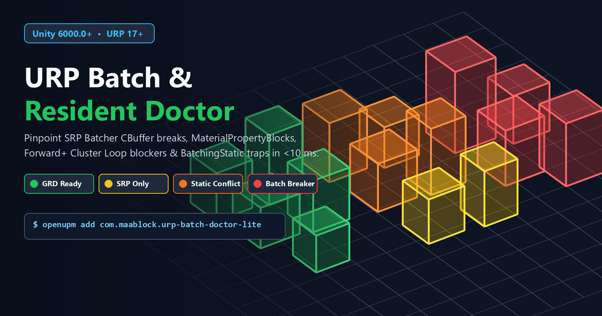

# URP Batch & Resident Doctor (Lite)

[](https://unity.com/)
[](https://docs.unity3d.com/Packages/com.unity.render-pipelines.universal@latest)
[](https://openupm.com/packages/com.maablock.urp-batch-doctor-lite/)
[](LICENSE.md)

**Stop clicking through 2,000 Frame Debugger draw calls one by one.**

**URP Batch & Resident Doctor** scans your Unity 6 (`6000.0+`) scene in **under 10 ms** and tells you **exactly** why your objects are failing **SRP Batcher** or getting silently excluded from Unity 6's **GPU Resident Drawer (`BatchRendererGroup`)**.



---

## Why Does `GPU Resident Drawer` or `SRP Batcher` Silently Fail in Unity 6?

Even experienced Unity developers hit hidden traps when migrating scenes or importing third-party 3D asset packs into Unity 6 URP:

1. **The `Forward` vs `Forward+` Trap:** Unity 6's `GPUResidentDrawer` requires cluster light loops (`Forward+` or `Deferred+`). If *any* `UniversalRendererData` on your URP Asset is still on classic `Forward` or legacy `Deferred`, Unity silently disables GPU Resident Drawer!
2. **The Player Build Stripping Trap:** If `Graphics Settings > BatchRendererGroup Variants` isn't set to `Keep All`, DOTS instancing variants work in the Editor or fail/strip in standalone Player builds.
3. **`BatchingStatic` Legacy Habits:** Marking props `Batching Static` merges meshes into giant static VBOs—blocking `GPUResidentDrawer` from performing GPU-driven per-instance frustum & occlusion culling.
4. **Hidden `MaterialPropertyBlock` Scripts:** A single script calling `renderer.SetPropertyBlock(...)` kicks that `MeshRenderer` out of **both** GPU Resident Drawer and SRP Batcher.
5. **Broken Third-Party Shaders:** Shaders missing `#pragma multi_compile _ DOTS_INSTANCING_ON` or having mismatched `CBUFFER_START(UnityPerMaterial)` layouts across `ForwardLit` and `ShadowCaster` passes break batching immediately.

**Batch Doctor Lite** catches every single one of these in one click—using Unity's native C++ `ShaderUtil` compiler diagnostics rather than fragile text regexes.

---

## Installation

### Option 1: Install via OpenUPM (Recommended)

```bash
openupm add com.maablock.urp-batch-doctor-lite
```

### Option 2: Install via Unity Package Manager (Git URL)

1. Open `Window > Package Manager` in Unity 6 (`6000.0+`).
2. Click **`+` > Add package from git URL...**
3. Paste:
   ```text
   https://github.com/MaaBlock/urp-batch-resident-doctor-lite.git
   ```

### Quick Start

Open **`Tools > URP Batch & Resident Doctor > Open Batch Doctor (Lite)`** and click **Scan Active Scene**.

---

## Pro Edition vs Lite

**Lite** is 100% free and MIT open-source for active-scene diagnostics.  
When you want **instant visual Scene View heatmaps, 1-click undoable project-wide fixes, offline Prefab auditing, and team HTML/CI reports**, upgrade to **URP Batch & Resident Doctor Pro**:

| Feature | Lite (MIT Open Source) | Pro Edition (Asset Store) |
| :--- | :---: | :---: |
| **Active Scene SRP Batcher & GPU Resident Audit** | ✅ | ✅ |
| **Native C++ `ShaderUtil` CBuffer & `DOTS_INSTANCING_ON` Check** | ✅ | ✅ |
| **URP `Forward+` Cluster Loop & `BRG KeepAll` Pipeline Validator** | ✅ | ✅ |
| **Grouped Culprit Summary & 1-Click Hierarchy Multi-Select** | ✅ | ✅ |
| **Live 3D Scene View Color Heatmap Overlay & Interactive HUD** | ❌ | ✅ **Pro** |
| **1-Click Undoable Auto-Fix: Configure Pipeline (`Forward+` / `KeepAll` / `GRD`)** | ❌ | ✅ **Pro** |
| **1-Click Undoable Auto-Fix: Strip `BatchingStatic` (Keep GI/Occluder Flags)** | ❌ | ✅ **Pro** |
| **1-Click Undoable Auto-Fix: Clear Rogue `MaterialPropertyBlock`s & Extra Slots** | ❌ | ✅ **Pro** |
| **Whole-Project Offline `.prefab` & Multi-Scene Batch Scanner + Fixer** | ❌ | ✅ **Pro** |
| **Standalone Dark-Mode HTML Executive Dashboard & CI JSON Report** | ❌ | ✅ **Pro** |
| **1-Click Interactive Demo Scene Generator** | ❌ | ✅ **Pro** |

> 🚀 **[Get URP Batch & Resident Doctor Pro on the Unity Asset Store (`u3d.as/4hrf`)](https://u3d.as/4hrf)** — *50% Launch Discount!*

---

## License

MIT © [MaaBlock](https://github.com/MaaBlock)
